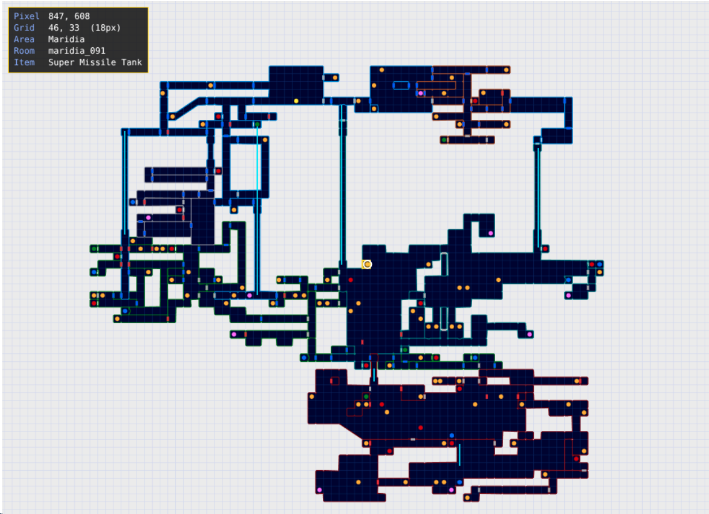

# Super Metroid Map Viewer

An interactive, canvas-based viewer for the Super Metroid world map, written in TypeScript (Vite, vanilla-ts). The map data (rooms, doors, items, save points and more) was extracted from a map image and is stored as plain JSON, so you can use it for rendering, pathfinding, randomizer tooling or whatever else you like.

> **Fan project.** This project is not affiliated with or endorsed by Nintendo. Super Metroid is a trademark and copyright of Nintendo.

## Features

- Renders every room as a polygon, colored by region (Crateria, Brinstar, Norfair, Wrecked Ship, Maridia, Tourian)
- Door markers by type (normal, missile, super, power bomb, boss)
- Item, save, map station and recharge station markers
- Mouse hover:
  - The grid tile under the cursor is highlighted
  - A corner panel shows pixel coordinates, grid column/row, area, room id, the nearest item and the door under the cursor
- Room graph helper (`buildGraph()`) and point hit-testing (`roomAt(x, y)`)

## Quick start

```bash
git clone https://github.com/<your-user>/<your-repo>.git
cd <your-repo>
npm install
npm run dev
```

Open the URL Vite prints (usually http://localhost:5173).

`tsconfig.json` needs `"resolveJsonModule": true` (and in `tsconfig.app.json` too, if your Vite template has one).

## Usage

```ts
import { render, roomAt, buildGraph } from './render';

const canvas = document.getElementById('map') as HTMLCanvasElement;

// scale = 0.6, options are optional
render(canvas, 0.6, {
  grid: 18,            // tile size in image pixels (default 18)
  gridOffset: [5, 6],  // image-pixel position of a tile corner (default [5, 6])
  showGrid: true,      // faint grid lines (the hover highlight is always on)
  hoverRadius: 10,     // pick radius for items and doors under the mouse
});

// Which room is at this image-space point?
console.log(roomAt(680, 233)?.id);

// Room adjacency, with door types, for pathfinding
const graph = buildGraph();
```

### About the grid

The map tiles are **18 px**, and tile walls are centered on `x = 5 + 18k` and `y = 6 + 18k`, so the grid does not start at the image corner. Column and row numbers in the hover panel count from the image's top-left corner.

## Data format

All coordinates are image pixels with the origin at the top-left. Types are in [`src/types.ts`](src/types.ts).

| Key | Contents |
| --- | --- |
| `metadata` | Game, source, image size, map area, region colors, notes |
| `regions` | Bounding box and room ids per region |
| `rooms` | 155 rooms: `id`, `region`, `bbox`, `polygon` |
| `doors` | 135 doors: `type`, `center`, `orientation` |
| `passages` | 7 dashed-line passages |
| `connections` | 124 room-to-room links (`a`, `b`, `kind`, `doorType`) |
| `markers` | 123 markers: saves, map and recharge stations, tanks, upgrades, each with its `room` |
| `bosses` | 10 bosses and mini-bosses with their rewards |
| `elevators` | 6 elevators |
| `unresolved_upgrades` | Upgrades that could not be located (see below) |

## How the data was extracted

The data comes from image processing on the map image, not from the game's ROM:

1. **Rooms:** each region's border colors were used as walls, and the remaining navy-filled areas were split into connected components. Their outlines were converted to polygons (OpenCV contours).
2. **Doors and passages:** door icons were found from their white outlines and classified by inner color. Dashed cyan, magenta and red lines were treated as passages.
3. **Connections:** each door or passage was linked to the rooms on either side of it.
4. **Markers:** saves, map stations and recharge stations were found by color block and letter shape. Tanks and upgrades were found by matching the icons from the image's legend.
5. **By hand:** elevator positions and boss panel positions were read by eye and are approximate.

The extraction scripts are not included in this repository yet.

## Known limitations

- **Merged rooms:** some rooms are merged where the map shows no door or divider between them, mostly in Maridia and Norfair.
- **Missing connections:** links exist only where a door or dashed passage is drawn, so some open connections may be missing.
- **Missile tanks:** 42 were found, but the game has 46.
- **Unlocated upgrades:** charge beam, spazer, ice beam, wave beam, bombs, Varia suit, Hi-Jump and speed booster are listed in `unresolved_upgrades` with their region only.
- **Approximate positions:** elevators and boss panels are hand-read.

Corrections and pull requests are welcome.

## Project structure

```
src/
  main.ts                  entry point (canvas setup, click handler)
  render.ts                drawing, hover panel, buildGraph, roomAt
  types.ts                 TypeScript types for the map data
  super_metroid_map.json   extracted map data
```

## Credits

- **Map image:** Super Metroid map by **Zeric** (© 2004, from GameFAQs). The original image is not included in this repository. The JSON data here is derived from it. Please see the original for the full artwork.
- **Super Metroid** © Nintendo.

## License

Choose a license for your own code (for example MIT) and add a `LICENSE` file. The extracted data is derived from Zeric's map, so mention that in the license notes.
